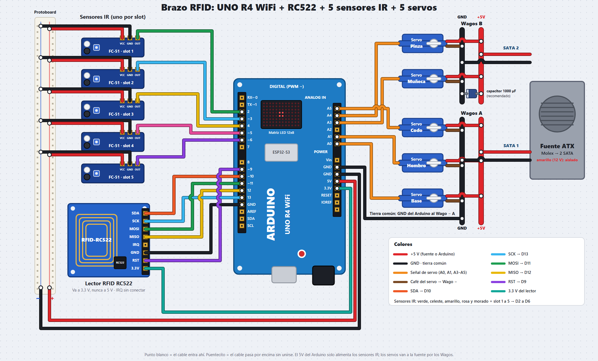
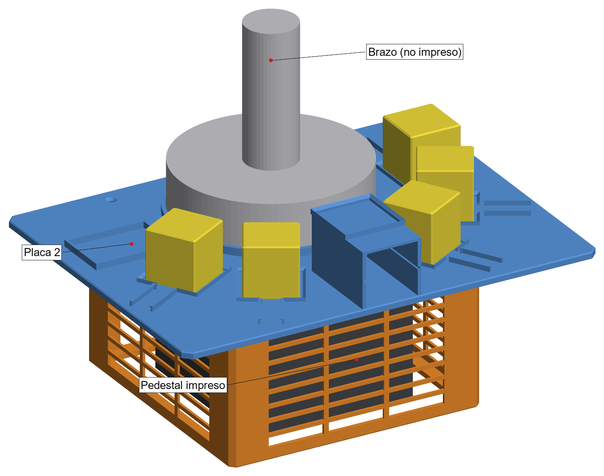
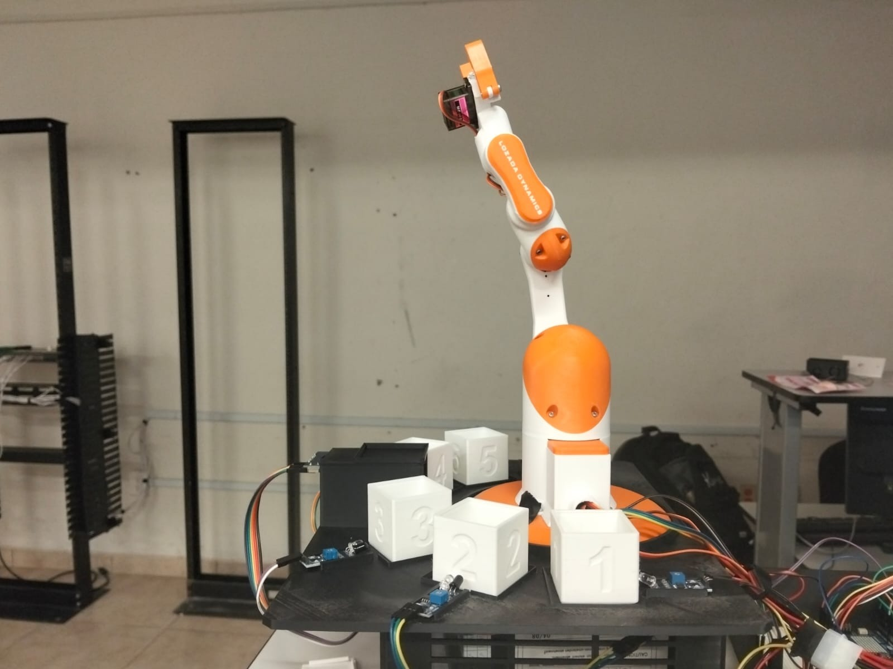
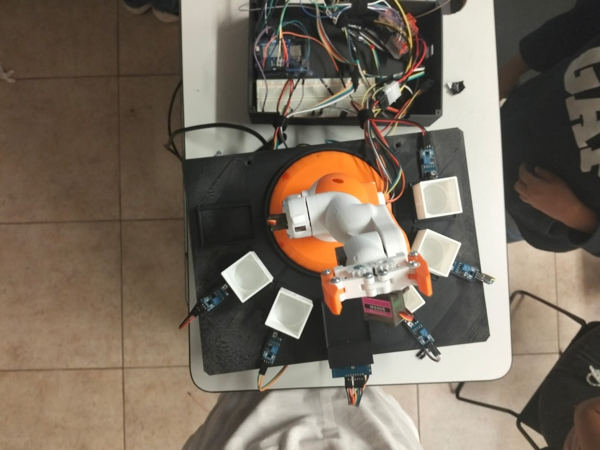
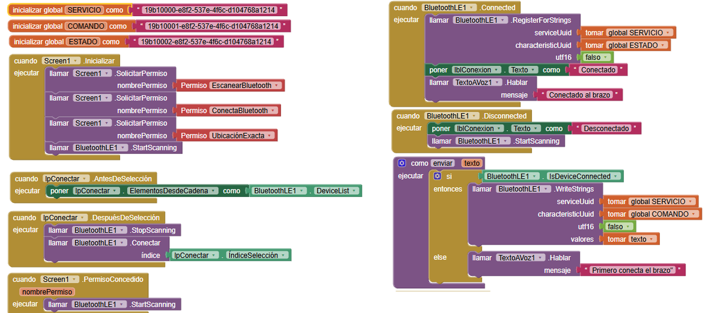
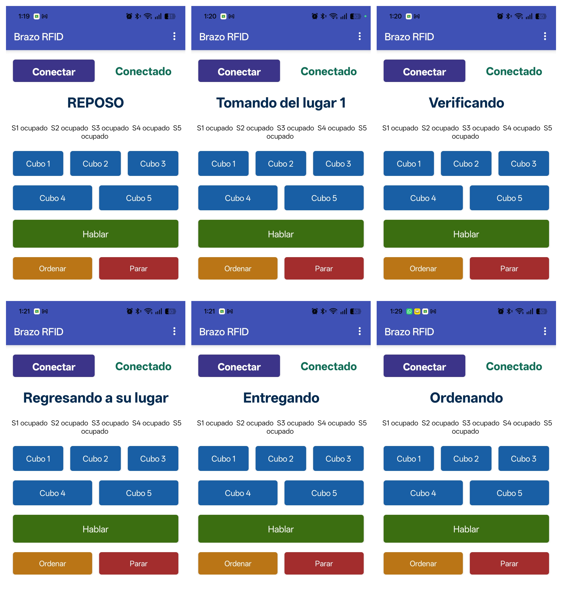
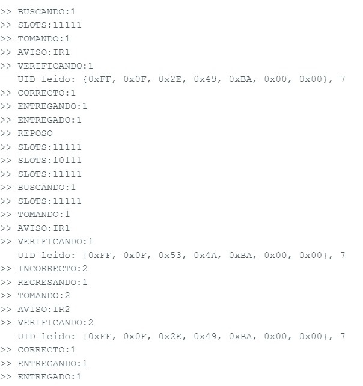

# Brazo robótico con estación RFID para búsqueda, detección y clasificación de objetos

## Descripción

Estación de asistencia con un brazo robótico de cinco servomotores, controlado por un Arduino UNO R4 WiFi, que busca, identifica y entrega objetos. Los objetos son cinco cubos impresos en 3D, numerados del 1 al 5, cada uno con una etiqueta RFID adhesiva por dentro.

Cinco sensores infrarrojos detectan qué posiciones están ocupadas, así que el brazo nunca visita una posición vacía. El brazo lleva cada cubo a una torre de verificación con un lector RFID RC522, lee su etiqueta y, si es el cubo pedido, lo deja en la zona de entrega; si no, lo regresa a su lugar y sigue buscando. Si el cubo no está, lo avisa. La orden `ORDENA` clasifica los cubos y deja cada uno en su posición.

Los cubos se piden desde una aplicación de MIT App Inventor, por voz o con botones, que se comunica con el Arduino por BLE, muestra el estado del brazo y anuncia cada resultado con voz. Toda la estructura de la estación se diseñó e imprimió en 3D.

## Integrantes

* Gabriel
* Javier
* Rosa

## Objetivos

* Controlar un brazo de cinco servomotores con movimientos suaves y una secuencia segura entre estaciones.
* Detectar la presencia de objetos con sensores infrarrojos filtrados.
* Identificar cada objeto por el UID de su etiqueta RFID con el lector RC522 (SPI).
* Buscar y entregar el objeto pedido revisando solo las posiciones ocupadas, y avisar si no se encuentra.
* Clasificar los objetos dejando cada uno en su posición.
* Comunicar el Arduino con una app móvil por BLE, con órdenes por voz y estado en pantalla y por voz.
* Guardar la calibración del brazo en la EEPROM.
* Diseñar e imprimir la estructura en 3D y documentar el armado, la conexión y la calibración.

## Herramientas y material utilizado

### Hardware

* Arduino UNO R4 WiFi
* Brazo robótico de 5 servomotores (base, hombro, codo, muñeca y pinza)
* Lector RFID RC522 y 5 etiquetas RFID adhesivas
* 5 sensores infrarrojos FC-51
* Fuente ATX con adaptador Molex a SATA y 4 conectores Wago 221-415
* Cables Dupont, tornillería y pijas
* Impresora Creality K2 Plus y filamento PLA

### Software

* Arduino IDE (librerías Servo, MFRC522, ArduinoBLE, SPI y EEPROM)
* Monitor Serie
* MIT App Inventor con la extensión BluetoothLE
* Python (trimesh) y OrcaSlicer para las piezas 3D

## Diagrama

Los servos se alimentan directamente de la fuente ATX a través de los Wagos, nunca del Arduino ni de la protoboard. El GND del Arduino se une al GND de los Wagos.

| Componente | Arduino UNO R4 WiFi |
| ---------- | ------------------- |
| Servo base | A0 |
| Servo hombro | A1 |
| Servo codo | A5 |
| Servo muñeca | A3 |
| Servo pinza | A4 |
| Sensores IR slots 1 a 5 | D2, D3, D4, D5, D6 |

| RC522 | Arduino UNO R4 WiFi |
| ----- | ------------------- |
| SDA | D10 |
| SCK | D13 |
| MOSI | D11 |
| MISO | D12 |
| RST | D9 |
| GND | GND |
| 3.3V | 3.3V (nunca a 5 V) |

[Ver carpeta Diagrama](Diagrama)

## Código

El programa principal conecta los servos uno por uno al arrancar, carga la calibración de la EEPROM, inicia el lector RC522 y anuncia el servicio BLE `BrazoRFID`. Las órdenes llegan por la app o por el Monitor Serie (`DAME n`, `ORDENA`, `ESTADO`, `HOME`, `PARA`), junto con comandos de calibración y de prueba. Cada paso se avisa a la app con mensajes como `BUSCANDO:3`, `INCORRECTO:5` o `ENTREGADO:3`.

[Ver código estacion_rfid_v2.ino](Codigo/estacion_rfid_v2.ino)

La carpeta también tiene los programas de prueba usados durante el desarrollo: `prueba_brazo_v2` (servos), `prueba_rfid` (lector) y `prueba_continuidad` (falsos contactos).

[Ver carpeta Código](Codigo)

## Impresión 3D

Se imprimieron el pedestal que cubre la fuente, la placa base con las cunas de los sensores y la torre del lector, la caja de la electrónica y los cinco cubos numerados: 18 h 35 min de impresión y 798 g de PLA en total.

[Ver carpeta Impresion3D](Impresion3D) (STL, G-code y vistas)

## Montaje

Más fotos del armado (placa con sensores y torre, caja de la electrónica) en la [carpeta Diagrama](Diagrama).

## Guías

El proceso completo quedó documentado en cuatro guías:

* [GUIA_PROYECTO](Reporte/GUIA_PROYECTO.pdf): guía general, calibración, comandos y mensajes.
* [GUIA_ARMADO](Reporte/GUIA_ARMADO.pdf): armado de las piezas impresas, sensores y lector.
* [GUIA_CONEXION](Reporte/GUIA_CONEXION.pdf): fuente, Wagos, servos y sensores.
* [GUIA_APP_INVENTOR](Reporte/GUIA_APP_INVENTOR.pdf): cómo se hizo la app.

## Aplicación

La app se conecta por BLE al brazo, recibe órdenes por voz o con botones y anuncia con voz cada resultado.

[Ver manual de bloques de la app](App/Manual_BrazoRFID.pdf)

[Ver capturas de la app](App/Capturas)

## Reporte

El reporte explica el diseño de la estación, la alimentación de los servos, la detección con IR, la verificación con RFID, los algoritmos de búsqueda y clasificación, la comunicación BLE y la app, junto con la metodología y los problemas resueltos.

[Ver reporte](Reporte/Reporte.pdf)

## Resultados

El brazo entrega el cubo pedido sin importar su posición, ignora las posiciones vacías, regresa los cubos incorrectos y avisa cuando el cubo no está. La orden `ORDENA` deja cada cubo en su posición, y la app muestra y anuncia el estado en cada paso.

En el Monitor Serie se ve una búsqueda del cubo 1 que primero revisa un cubo equivocado (INCORRECTO:2), lo regresa a su lugar y entrega el correcto en el siguiente slot:

## Video

En el siguiente video se muestra el funcionamiento de la estación: búsqueda, verificación y entrega de los cubos desde la app.

[Ver video del proyecto](https://youtube.com/shorts/lXrpZO3_9lc)

[Ver carpeta Video](Video)

## Conclusiones

El proyecto mostró que en un sistema con actuadores la parte eléctrica pesa tanto como el código: los temblores del brazo venían de la corriente de los servos y de uniones flojas, no del programa. También se comprobó la importancia de probar cada parte por separado, de guardar la calibración en la EEPROM para ajustar sin reprogramar y de confirmar con el lector RFID lo que los sensores infrarrojos no pueden asegurar.
