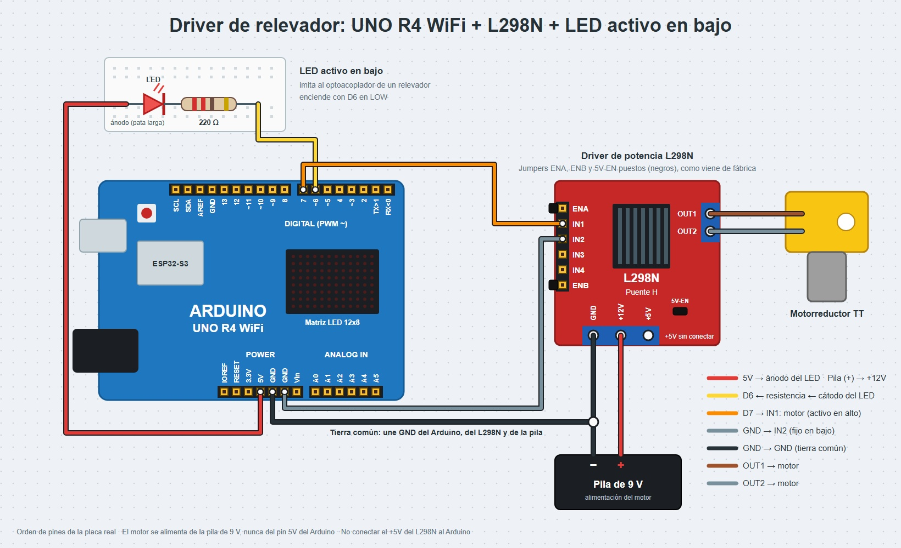
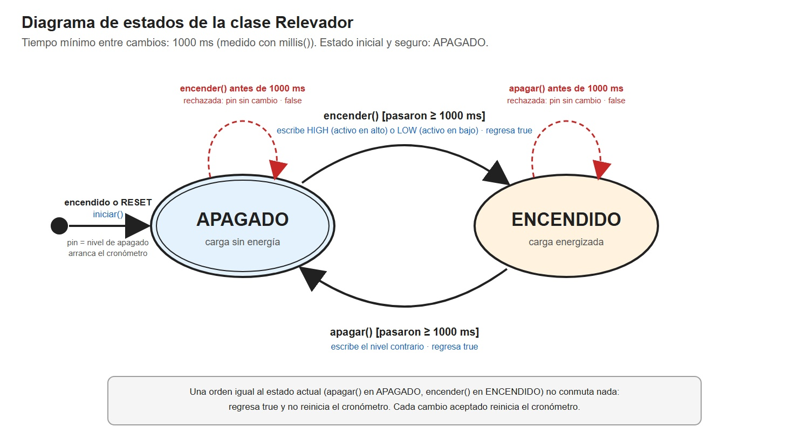
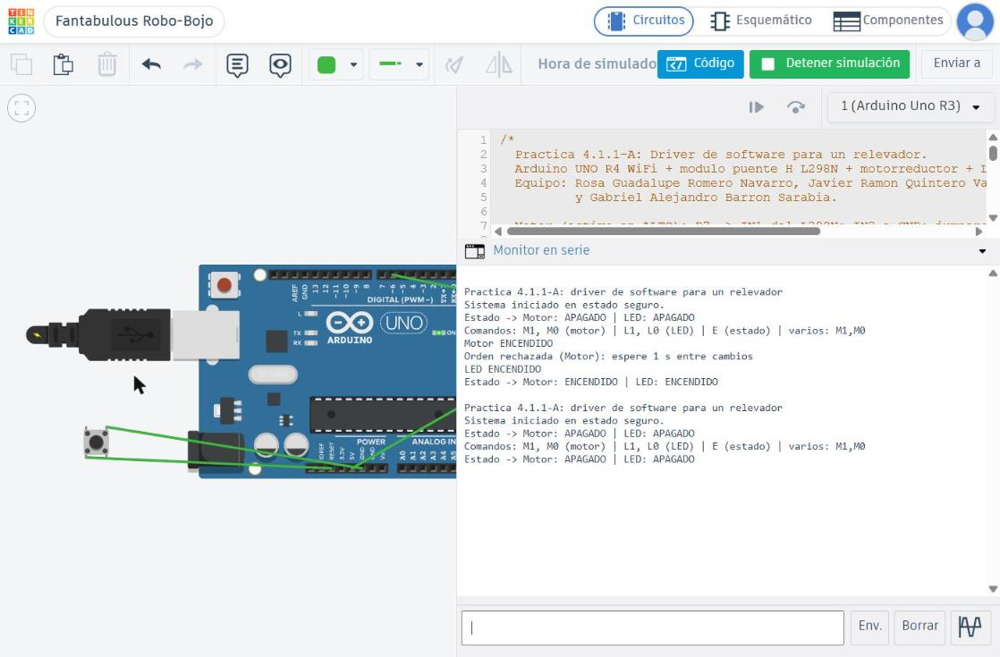

# Driver de software para un relevador

## Descripción

En esta práctica (4.1.1-A) se modeló por software un relevador mediante una clase en C++ llamada `Relevador`, que encapsula el estado del actuador, las órdenes que acepta y sus reglas de seguridad. Se usó un Arduino UNO R4 WiFi.

Como no se contaba con un módulo de relevadores, se usaron dos actuadores que lo representan. El primero es un canal del puente H L298N con un motorreductor, que hace de "relevador electrónico" y se activa con nivel alto. El segundo es un LED conectado "al revés", que imita al optoacoplador de un módulo de relevador real y se activa con nivel bajo. Los dos se controlan con la misma clase.

La clase recuerda si el actuador está encendido o apagado y traduce cada orden al nivel de pin correcto. También impide conmutar más de una vez por segundo y garantiza que, al encender o reiniciar el sistema, la carga quede apagada. El programa principal nunca escribe en los pines y no usa `delay()`: recibe órdenes por el Monitor Serie y se las pasa a los objetos.

## Integrantes

* Gabriel Alejandro Barrón Sarabia
* Javier Ramón Quintero Valdez
* Rosa Guadalupe Romero Navarro

## Objetivos

* Abstraer el comportamiento de un relevador en un modelo de software con estados, órdenes y restricciones.
* Aplicar encapsulamiento en C++ para proteger el hardware de órdenes incorrectas.
* Resolver dentro del software la diferencia entre actuadores "activo en alto" y "activo en bajo".
* Hacer cumplir un tiempo mínimo de 1000 ms entre cambios usando `millis()`, sin `delay()`.
* Garantizar un estado seguro (apagado) al encender o reiniciar el sistema.
* Separar la parte de señal (Arduino) de la parte de potencia (fuente del motor).

## Herramientas y material utilizado

### Hardware

* Arduino UNO R4 WiFi y cable USB-C
* Módulo puente H L298N
* Motorreductor DC (tipo TT, 3–6 V)
* Pila de 9 V para el motor (la práctica pide 2 pilas 18650 en serie, ≈ 7.4 V; se cambió porque el portapilas hacía falso contacto)
* LED
* Resistencia de 220 Ω
* Protoboard
* Cables jumper macho-macho y macho-hembra

### Software

* Arduino IDE
* Monitor Serie
* Tinkercad (simulación)

## Diagrama

### Conexiones

El Arduino solo da la orden; la energía del motor sale de la pila de 9 V y la conmuta el L298N.

| Parte de potencia (motor) | Conexión |
| ------------------------- | -------- |
| Positivo de la pila de 9 V | +12V del L298N |
| Negativo de la pila de 9 V | GND del L298N |
| GND del L298N             | GND del Arduino (tierra común, obligatoria) |
| Motorreductor             | OUT1 y OUT2 |
| Jumpers ENA y 5V-EN       | Puestos |
| +5V del L298N             | Sin conectar |

| Parte de señal | Conexión |
| -------------- | -------- |
| D7 del Arduino | IN1 del L298N (motor, activo en alto) |
| IN2 del L298N  | GND |
| 5V del Arduino | Ánodo del LED (pata larga) |
| Cátodo del LED | Resistencia de 220 Ω → D6 (LED, activo en bajo) |




En la foto ya se había retirado la pila de 9 V que alimentaba el motor.

### Diagrama de estados

El relevador tiene dos estados: APAGADO, que es el estado inicial y seguro, y ENCENDIDO. Un cambio solo se acepta si pasaron al menos 1000 ms desde el anterior. Si una orden llega antes, se rechaza y el pin no cambia.



[Ver carpeta Diagrama](Diagrama)

## Código

La clase `Relevador` guarda como datos privados el pin que controla, si es activo en bajo, el estado actual, el momento del último cambio y el tiempo mínimo entre cambios (1000 ms). Sus métodos públicos son los que pide la práctica:

| Método | Qué hace |
| ------ | -------- |
| `iniciar()` | Escribe el nivel de "apagado", configura el pin como salida y arranca el cronómetro |
| `encender()` | Enciende solo si ya pasó el tiempo mínimo; regresa `true` si lo logró |
| `apagar()` | Apaga solo si ya pasó el tiempo mínimo; regresa `true` si lo logró |
| `estaEncendido()` | Informa el estado actual |

La traducción de la orden al nivel del pin está en un solo lugar: el método privado `nivel()` regresa `HIGH` para encender un actuador activo en alto y `LOW` para encender uno activo en bajo. Si una orden llega antes de que pase el tiempo mínimo, el método termina antes de llegar a `digitalWrite()`, así que el pin no cambia.

En `iniciar()` el nivel de apagado se escribe antes y después de volver salida el pin, para que el actuador no parpadee al arrancar. El arranque cuenta como un cambio, así que durante el primer segundo después de un RESET el sistema rechaza las órdenes y un reinicio no puede hacer conmutar la carga de inmediato. Una orden igual al estado actual (por ejemplo, `M0` con el motor apagado) no conmuta nada y no reinicia el cronómetro.

Se crean dos objetos de la misma clase:

```cpp
Relevador motor(PIN_MOTOR, false);   // D7, L298N: activo en alto.
Relevador led(PIN_FOCO, true);       // D6, LED al revés: activo en bajo.
```

El `loop()` solo lee el Monitor Serie sin bloquear: junta los caracteres y ejecuta la orden al recibir un fin de línea, una coma o un espacio. Si el Monitor Serie está en "Sin ajuste de línea", la ejecuta tras 50 ms sin recibir caracteres.

| Comando | Acción |
| ------- | ------ |
| `M1` / `M0` | Encender / apagar el motor |
| `L1` / `L0` | Encender / apagar el LED |
| `E` | Mostrar el estado de ambos |
| `M1,M0` | Varias órdenes seguidas en una línea (para la prueba de seguridad 1) |

[Ver código Driver_Relevador.ino](Codigo/Driver_Relevador.ino)

[Ver carpeta Código](Codigo)

## Pruebas

1. **Prueba de seguridad 1 (órdenes demasiado seguidas):** se envía `M1,M0` en una sola línea. El motor enciende y la segunda orden se rechaza con el mensaje "Orden rechazada (Motor): espere 1 s entre cambios".
2. **Prueba de seguridad 2 (reinicio):** con el motor encendido se presiona el botón RESET del Arduino. Al reiniciar, `iniciar()` deja los dos actuadores apagados y el Monitor Serie lo confirma.
3. **Prueba de inversión:** si el objeto del LED se crea por error como activo en alto (`Relevador led(PIN_FOCO, false);`), el modelo queda al revés de la realidad. Al arrancar, `iniciar()` escribe `LOW` creyendo que apaga, pero con el ánodo en 5V ese `LOW` enciende el LED. Después, `L1` escribe `HIGH` y el LED se apaga, mientras el programa reporta "LED ENCENDIDO". Con un relevador real, la carga quedaría energizada justo después de cada reinicio, que es lo contrario al estado seguro.

## Preguntas de reflexión

**1. ¿Por qué el LED se enciende con LOW y no con HIGH? Explica el recorrido de la corriente.**

Porque el ánodo del LED está conectado de forma fija a los 5V del Arduino. La corriente recorre 5V → ánodo → cátodo → resistencia de 220 Ω → pin D6, y para que circule el otro extremo tiene que estar a un voltaje menor. Cuando D6 está en `LOW` (0 V) hay 5 V de diferencia, el pin absorbe la corriente y el LED se enciende. Cuando D6 está en `HIGH` (5 V), los dos extremos están al mismo voltaje, no circula corriente y el LED se apaga. Lo mismo pasa con el optoacoplador de un módulo de relevadores, cuyo LED interno está conectado igual.

**2. ¿Qué ventaja tiene que la regla del tiempo mínimo viva dentro de la clase y no en el `loop()`?**

Que la regla no se puede olvidar ni saltar. Cualquier parte del programa que mande encender o apagar pasa por la clase y queda protegida, sin tener que repetir la comprobación en cada lugar. Además, cada objeto lleva su propio cronómetro, así que el motor y el LED respetan su tiempo de forma independiente, y el `loop()` se queda corto y fácil de leer. Si la regla cambia (por ejemplo, a 2 s), se modifica en un solo lugar.

**3. ¿Por qué un relevador real no sirve para controlar velocidad con PWM?**

Porque es un interruptor mecánico. Una bobina mueve un contacto que tarda varios milisegundos en cerrar o abrir y rebota al hacerlo. El PWM del Arduino conmuta cientos de veces por segundo, una velocidad que el relevador no puede seguir. Además, cada conmutación desgasta los contactos y genera chispas, y un relevador típico dura del orden de cien mil operaciones con carga: a esa frecuencia se acabaría en minutos. Para regular velocidad se usan interruptores electrónicos, como los transistores del puente H o un MOSFET.

**4. ¿Por qué el estado seguro es "apagado"? Da un ejemplo industrial donde convenga lo contrario (contacto NC).**

Porque si el sistema se reinicia, pierde energía o falla el control, lo menos peligroso suele ser que la máquina se detenga. Un motor que arranca solo después de un RESET puede lastimar a quien está trabajando cerca. Lo contrario conviene cuando detener la carga es lo peligroso. Por ejemplo, el extractor de gases de una mina o de un laboratorio químico, o la bomba de enfriamiento de un horno industrial, deben seguir funcionando aunque falle el control. Por eso se conectan al contacto normalmente cerrado (NC), que queda cerrado cuando el relevador pierde la energía.

**5. ¿Por qué es obligatoria la tierra común entre el portapilas y el Arduino?**

Porque un voltaje siempre se mide respecto a una referencia. Cuando D7 pone 5 V en IN1, esos 5 V son respecto a la tierra del Arduino. El L298N interpreta la señal respecto a su propia tierra, que es el negativo de la pila. Si las tierras no están unidas, la señal no tiene camino de regreso y el L298N no tiene una referencia para saber si IN1 está en alto o en bajo. La entrada queda "flotando" y el motor puede no responder o encender al azar.

**6. Si mañana cambiaras el L298N por un módulo de relevador real, ¿qué partes del programa tendrías que modificar?**

Solo la línea donde se crea el objeto: el pin y si es activo en bajo. La mayoría de los módulos de relevadores con optoacoplador son activos en bajo, así que el objeto quedaría como `Relevador motor(PIN_MOTOR, true);`. La clase, sus reglas y el `loop()` no cambian, porque el resto del programa le habla al relevador con órdenes (encender, apagar) y no con niveles de pin. Lo que sí cambiaría es el cableado: el módulo se alimenta con VCC y GND, recibe la señal en IN, y la carga se conecta en COM y NO.

## Reporte

En el reporte se explica el diseño de la clase `Relevador`, la traducción entre lógica activa en alto y activa en bajo, la regla del tiempo mínimo con `millis()` y el estado seguro. También incluye las pruebas realizadas y las respuestas a las preguntas de reflexión.

[Ver reporte](Reporte/Reporte.pdf)

## Resultados

La captura del Monitor Serie se tomó en la simulación de Tinkercad, con el mismo código en un Arduino UNO R3. El circuito tiene el LED activo en bajo en D6 y un pulsador entre RESET y GND que hace de botón RESET. Tinkercad no tiene el módulo L298N, así que el estado del motor se comprueba en el Monitor Serie.

* Al arrancar, el sistema reporta "Sistema iniciado en estado seguro" con el motor y el LED apagados.
* **Prueba de seguridad 1:** con `M1,M0` en una sola línea, el motor se encendió y la segunda orden se rechazó con "Orden rechazada (Motor): espere 1 s entre cambios".
* Con `L1` el LED se encendió, y `E` reportó los dos actuadores ENCENDIDOS.
* **Prueba de seguridad 2:** al presionar RESET con el motor y el LED encendidos, el programa se reinició y volvió a arrancar en estado seguro. El comando `E` confirmó los dos actuadores APAGADOS.



## Video

En el siguiente video se muestra el control del motor y del LED desde el Monitor Serie, el rechazo de órdenes demasiado seguidas y el estado seguro después del RESET.

[Ver video de la práctica](https://youtube.com/shorts/ZHlO-EXlY4w?feature=share)

[Ver carpeta Video](Video)

## Conclusiones

La práctica permitió comprender que un actuador no se controla con pines sueltos repartidos por el programa, sino con un modelo de software que le da significado a las órdenes. Al encapsular el relevador en una clase, el resto del programa solo dice "encender" o "apagar" y no necesita saber qué nivel de pin requiere cada dispositivo.

También se comprendió que la diferencia entre activo en alto y activo en bajo se puede resolver por completo dentro del software. La misma clase controló el motor y el LED cambiando un solo parámetro, y el error de marcar mal ese parámetro mostró por qué el modelo debe coincidir con el hardware real.

Finalmente, las reglas de seguridad mostraron un principio importante de los sistemas de control: el software debe proteger al hardware de órdenes incorrectas. El tiempo mínimo entre cambios cuida las partes mecánicas, y el estado seguro al arrancar evita que la carga se energice sola después de un reinicio.
